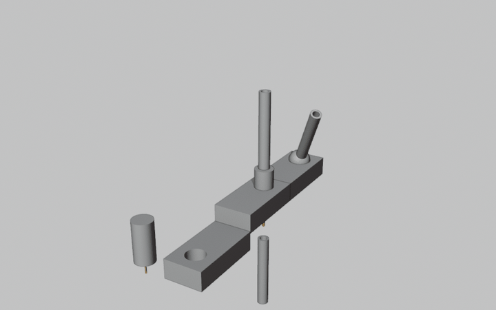

# FORMLYNX Inventor Import

A Blender extension that imports **Autodesk Inventor assemblies (.iam) and parts (.ipt)** as meshes – no Inventor installation, no OpenCASCADE, no internet connection.

The importer reads the display data that Inventor saves inside every file. You get the shapes and colours you saw in Inventor: assemblies with the part names from the model browser, parts with one object per solid body and the colours of single faces. Joints of an assembly become an armature you can pose.

*An assembly with revolute, cylindrical, planar and ball joints. Each orange stick is one bone of the imported rig.*

## Features
**Geometry**
- **File › Import › Inventor (.iam, .ipt)**, several files at once
- Part names taken from the Inventor model browser (e.g. `Bracket:2`)
- Assembly structure as **collections**, as **empties** (parts parented per assembly) or **flat** in one collection
- Parts (.ipt): one object per solid or surface body, colours per face, per feature and per part
- **Materials** from the part colours, named after the Inventor appearance in the language the file was saved in
- Identical parts share one mesh – large assemblies stay light
- Correct scale in millimetres, respecting the scene unit scale
- Up axis: automatic (Z-up like Inventor) or Y-up files rotated to Z-up
- Smooth shading kept via custom normals

**Data**
- **iProperties** (part number, description, material …) as custom properties. Assemblies also read their part files when they are found next to the assembly or at the saved path.
- **Parameters** of parts (model, user and sheet metal parameters) as custom properties, with units and formulas

**Joints as rig** (assemblies)
- One bone per Inventor joint, the parts follow their bone
- Degrees of freedom as bone locks: revolute turns about its axis, cylindrical also slides along it, planar slides in its plane, ball turns freely, rigid joins parts without a bone
- Joint limits become IK limits and a *Limit Rotation* constraint
- IK controls on chains with at least two joints that turn about different axes
- Closed loops are kept closed by an IK target
- The rest pose is the pose saved in Inventor – nothing moves on import

**General**
- Pure Python, works offline, reads only the files you pick
- English and German interface

## Limits
- A part without saved display data cannot be imported; the import names it and continues with the other files.
- Geometry comes from the display cache, so it is a mesh, not an editable CAD model. The level of detail is the one Inventor used for display.
- Joints: slider joints and distance limits of slider and cylindrical joints are not confirmed against real files yet. Assembly constraints (mate, flush, tangent, symmetry) are read but do not restrict the rig yet.
- Tested with files from Inventor 2023, 2025 and 2026. The file format is not documented; if a file cannot be read, the import names it and continues with the other files.

## Requirements
Blender 4.5 or newer.

## Installation
1. Download the zip from the [Releases](../../releases) page.
2. In Blender: **Edit › Preferences › Get Extensions**, menu **⌄ › Install from Disk…**, pick the zip.

## How to use
1. **File › Import › Inventor (.iam, .ipt)**
2. Pick one or more `.iam` or `.ipt` files.
3. In the side panel of the file browser choose how assemblies are organised and whether materials, iProperties and the joint rig are created.

To pose a rig, select the armature and switch to Pose Mode. Rotate a joint bone about its own Y axis – that is the joint axis. Bones inside an IK chain are pulled back by the IK; drag the IK control bone instead, or mute the IK constraint.

## Problems and questions
Please open an [issue](../../issues). Name the Inventor version that saved the file and what went wrong. Attach a file only if you are allowed to share it.

## Support
The extension is free. If it saves you time, you can buy me a coffee on [Ko-fi](https://ko-fi.com/frederikv) – it helps to keep the importer up to date with new Inventor versions.

## Development
This repository is the source of the extension.
- Package: `python tools/build.py` creates `dist/formlynx_inventor_import-<version>.zip` with Blender's extension builder.
- Tests: `tests/test_inventor.py` installs the package into an empty Blender profile and imports the test files. The test files are not part of the repository.
- Changes: see [CHANGELOG.md](CHANGELOG.md).

Pull requests are welcome.

## License
GPL-3.0-or-later, see [LICENSE](LICENSE).

Autodesk and Inventor are registered trademarks of Autodesk, Inc. This extension is not affiliated with or endorsed by Autodesk.
